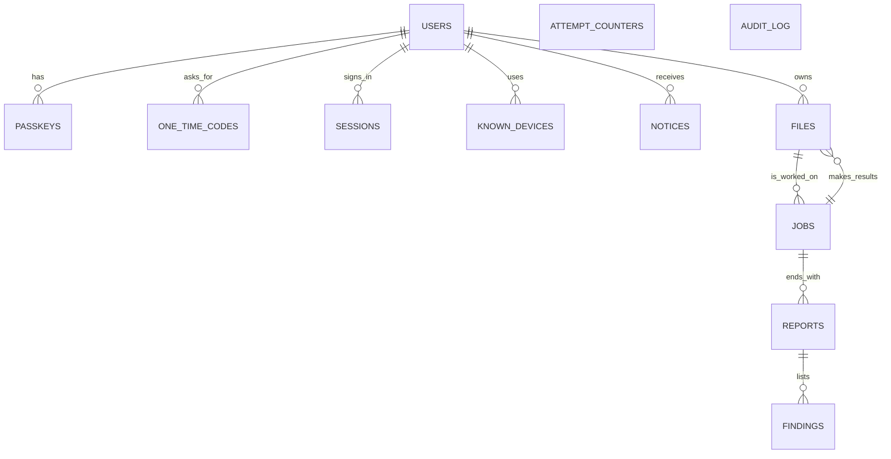

# Data model

<!-- Built by build_data_model.py. Edit the builder, not this file. -->

The database is **PostgreSQL**. File contents live in a private folder, outside the database.
Interactive drawing: open `doc2all-data-model.html` in a browser.

The audit log has no foreign key to users: it keeps the random user id, so it survives account deletion.

## Tables

### Users

One row per person. Requirements: SR-01, SR-06, SR-27.

| Column | What it holds | Protection |
| --- | --- | --- |
| `id` | random, 128 bits | random |
| `email` | one account per address |  |
| `email_confirmed_at` | empty until the emailed code is entered |  |
| `password_hash` | slow, salted hash (Argon2id). Never the password | saved as hash |
| `role` | user or administrator |  |
| `email_code_step` | can be off only if a passkey exists |  |
| `file_notices, finish_sound` | on or off |  |
| `created_at` |  |  |

### Passkeys

A user can have several. Requirements: SR-28.

| Column | What it holds | Protection |
| --- | --- | --- |
| `id` | random | random |
| `user_id` | whose it is | owner check |
| `credential_id` | which key the device used |  |
| `public_key` | public half only. The private half stays on the device |  |
| `sign_count` | helps notice a copied key |  |
| `name` | for example Laptop |  |
| `added_at, last_used_at` |  |  |

### One-time codes

Codes sent by email. Requirements: SR-25, SR-26.

| Column | What it holds | Protection |
| --- | --- | --- |
| `id` |  |  |
| `user_id` | whose it is | owner check |
| `purpose` | confirm email, sign in, reset or change |  |
| `code_hash` | hash made with a server secret. Never the code | saved as hash |
| `expires_at` | 10 minutes |  |
| `wrong_tries` | dead at 5 |  |
| `used_at` | works once |  |

### Sessions

Who is signed in now. Requirements: SR-03, SR-27.

| Column | What it holds | Protection |
| --- | --- | --- |
| `key` | random, kept in an HTTP-only cookie | random |
| `user_id` | whose it is | owner check |
| `second_step_at` | empty means not signed in yet |  |
| `passkey_challenge` | new each time, works once |  |
| `device_name` | shown in Settings |  |
| `last_seen_at` | ends after 30 minutes idle |  |

### Known devices

Needed to notice a sign-in on a new device. Requirements: SR-29.

| Column | What it holds | Protection |
| --- | --- | --- |
| `id` |  |  |
| `user_id` | whose it is | owner check |
| `device_hash` | hash of a random value in a cookie | saved as hash |
| `device_name` | for example Phone |  |
| `first_seen_at, last_seen_at` |  |  |

### Attempt counters

Counts tries, so limits survive a restart. Requirements: SR-02, SR-09, SR-25.

| Column | What it holds | Protection |
| --- | --- | --- |
| `id` |  |  |
| `kind` | sign-in, code sent or upload |  |
| `who_hash` | hash of the email, network address or user id | saved as hash |
| `at, success` | removed after 24 hours |  |

### Files

The record. The content sits in the private folder. Requirements: SR-05, SR-08, SR-10, SR-18.

| Column | What it holds | Protection |
| --- | --- | --- |
| `id` | random, 128 bits | random |
| `owner_id` | checked on every request | owner check |
| `job_id` | empty for an upload, set for a result |  |
| `shown_name` | for display only, never a path |  |
| `stored_name` | random name in the private folder | random |
| `type` | decided from the first bytes |  |
| `size, pages` | within the limits |  |
| `delete_after` | upload time plus 24 hours |  |
| `deleted_at` | set when the content is gone |  |

### Jobs

One piece of work on one file. Requirements: SR-12, SR-15, SR-17.

| Column | What it holds | Protection |
| --- | --- | --- |
| `id` | random, 128 bits | random |
| `owner_id` | checked on every request | owner check |
| `file_id` | the upload |  |
| `action` | convert, clean, scan or black out |  |
| `choices` | what the user chose to keep |  |
| `outside_ocr_agreed_at` | empty means the text stays here |  |
| `status` | waiting, running, done or failed |  |
| `started_at, finished_at` | stopped after 60 seconds |  |
| `error_code` | a code, never file content |  |

### Safety reports

The proof shown to the user. Requirements: SR-15, SR-18.

| Column | What it holds | Protection |
| --- | --- | --- |
| `id` | random | random |
| `job_id` | owner is the job's owner | owner check |
| `result` | all clear, something kept or problem |  |
| `created_at` |  |  |

### Findings

One line of a report. Requirements: SR-15, SR-19.

| Column | What it holds | Protection |
| --- | --- | --- |
| `id` |  |  |
| `report_id` | which report |  |
| `kind` | macro, author, phone number and so on |  |
| `how_many` | a number. Never the value that was found |  |
| `action` | removed, kept or still there |  |

### Notices

What the bell shows. Requirements: SR-29.

| Column | What it holds | Protection |
| --- | --- | --- |
| `id` |  |  |
| `user_id` | whose it is | owner check |
| `kind` | the text is built from this |  |
| `file_id` | only for file notices |  |
| `pinned` | security notices wait for an answer |  |
| `created_at, read_at, answered_at` |  |  |

### Audit log

Who did what, and when. Lines are only added. Requirements: SR-19, SR-20.

| Column | What it holds | Protection |
| --- | --- | --- |
| `id, at` | order and time |  |
| `actor_id` | the random user id only. No name, no email |  |
| `action, result` | for example Clean file, OK |  |
| `target_id` | file or job id. No file name |  |
| `previous_hash` | fingerprint of the line before, made with a server secret | saved as hash |

## When each thing is removed

| Data | Removed |
| --- | --- |
| File contents (uploads and results) | After 24 hours, or at once when the user presses Delete |
| File records, jobs, reports, findings (the history) | When the user removes them from History, or deletes the account |
| One-time codes | After use or after 10 minutes |
| Sessions | At sign-out, or after 30 minutes idle |
| Attempt counters | After 24 hours |
| Users, passkeys, known devices, notices | When the account is deleted |
| Audit log | Stays. It never holds a name, an email, a file name or file content |

## Database accounts

- The app account reads and writes the tables. On the audit log it can only add and read.
- The setup account owns the tables and runs changes. The running app never uses it.
- The sandbox runner has no database account.

## Decisions

- **Database:** Use PostgreSQL. It can let the app add and read audit lines but never change them. SQLite cannot limit one table like that.
- **New device notice:** Add one more needed cookie that holds a random value. Without it the app cannot know a device is new. The Privacy screen would list three cookies.
- **History:** Keep the file name in History after the content is deleted, until the user removes it. The user sees what happened. The name can itself be personal, so it can be removed.
- **Administrator:** Show ids on the Records screen, never file names. A file name can reveal what a document is about.
- **Audit log:** Give each line the fingerprint of the line before. Someone with database access who changes a line can then be noticed.

## Limit to remember

The fingerprint chain shows a changed line, or a line removed from the middle. It cannot show that the newest
lines were cut off. Keep a copy of the latest fingerprint outside the database if that matters.
