# Screens

<!-- Built by build_screens_doc.py from screens.src.html. Edit the source, not this file. -->

Open `doc2all-screens.html` in a browser to see every view, light and dark, computer and phone.
The pictures below are light mode, computer view.

## Rules for every screen

- Light and dark mode must both work. The app must fit a phone about 400 px wide (NFR-06).
- Keyboard only must work, with text contrast of at least 4.5:1 (NFR-07).
- Font Nunito. Navy `#14305C`, blue `#2F6BFF`, scan cyan `#19B5D6`, mint `#22B573`, coral `#EF5350`, ginger `#F2994A`.
- The cat is live and animated, with four moods: hello, checking, all clear, alert.
- Top bar: logo, Tools, History, a bell with a count, and a profile menu (Settings, Sign out).
- Phone: only the logo on top, and a bottom bar with Tools, History, Alerts and Profile.
- Before sign-in there is no menu (logo, plus Privacy, Cookies and About links). An administrator gets Audit log and Records.
- The menu is dimmed while a question is open. The phone bottom bar is hidden before sign-in and during questions.
- A security notice stays pinned at the top until the user answers it.
- Buttons are centred on result screens, the main action first.
- Use words that fit any device ("Confirm on your device"). Password strength is Weak, Medium or Strong, with no bars.
- After a password reset, say an email was sent and ask the user to sign in.

## All screens

| # | Screen | Group | Views |
| --- | --- | --- | --- |
| 1 | Sign-in | Getting in | Normal, First visit, Wrong password, Locked out |
| 2 | Create account | Getting in | Details, Email code |
| 3 | Second step | Getting in | Choose, Passkey, Email code |
| 4 | Forgot password | Getting in | Email, Code, New password, Done |
| 5 | Upload and choose | Doing the work | Choose, Clean options, Black out preview, Checking, File refused |
| 6 | Consent for outside OCR | Doing the work | Ask |
| 7 | Safety report | Doing the work | All clear, Something kept, Problem found |
| 8 | History | Looking after files | Your files, Pinned notice, Notifications, Profile menu, Session ended |
| 9 | Delete confirmation | Looking after files | Ask, Deleted |
| 10 | Settings | Looking after files | Security, Confirm it is you, Privacy, Notifications, About |
| 11 | Audit log (admin) | Admin | Log, One record |

## 1. Sign-in

Wrong email and wrong password give the same message, so nobody can learn which emails have accounts. After five wrong tries the button stops working and the cat tells the user when to come back. The first visit shows a short cookie notice, and Privacy, Cookies and About are one click away on every sign-in screen.

- Views: Normal, First visit, Wrong password, Locked out
- Requirements: SR-01, SR-02, SR-21, AC-07

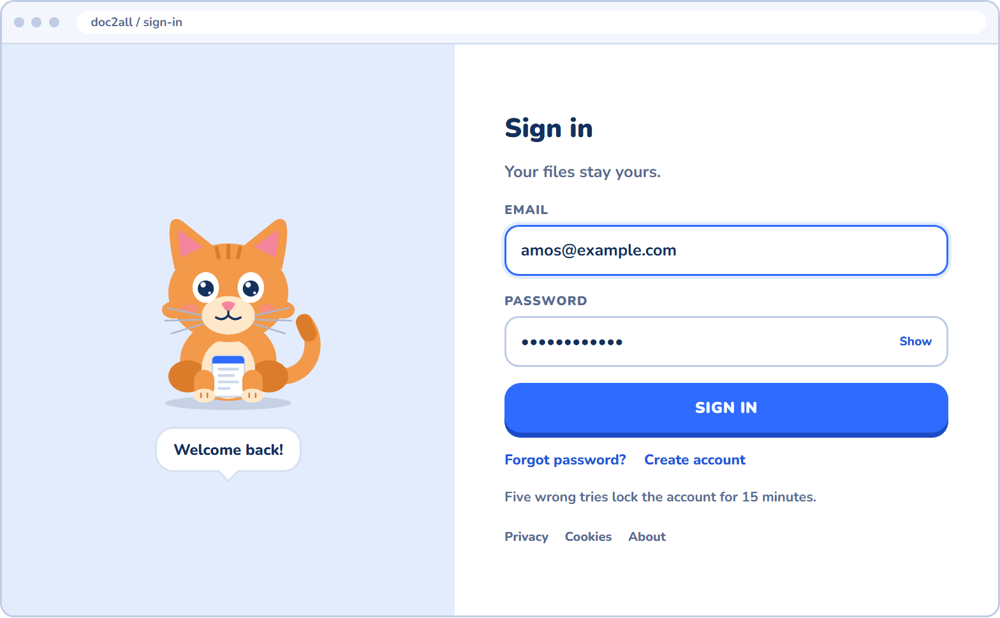

## 2. Create account

The password meter says what is missing in plain words. The address is confirmed with a code before the account works.

- Views: Details, Email code
- Requirements: FR-09, SR-01, SR-25

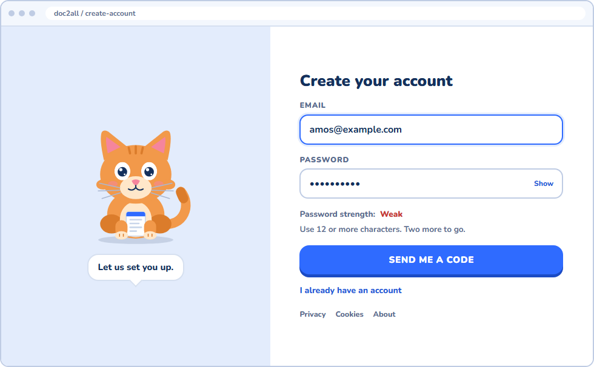

## 3. Second step

The passkey is the big, friendly button. The email code is the smaller choice. A passkey only works on our own address, so a fake site gets nothing.

- Views: Choose, Passkey, Email code
- Requirements: FR-11, SR-27, SR-28, SR-25, AC-14, AC-16

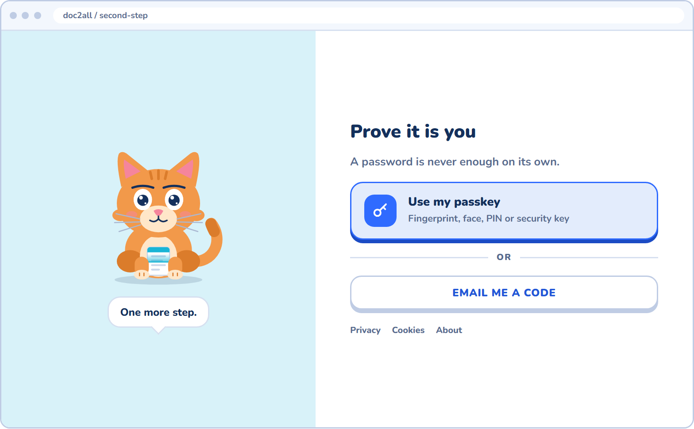

## 4. Forgot password

The screen never says whether the email has an account. A reset also asks for the second step, and signs the user out everywhere else.

- Views: Email, Code, New password, Done
- Requirements: FR-10, SR-25, SR-26, AC-13, AC-15

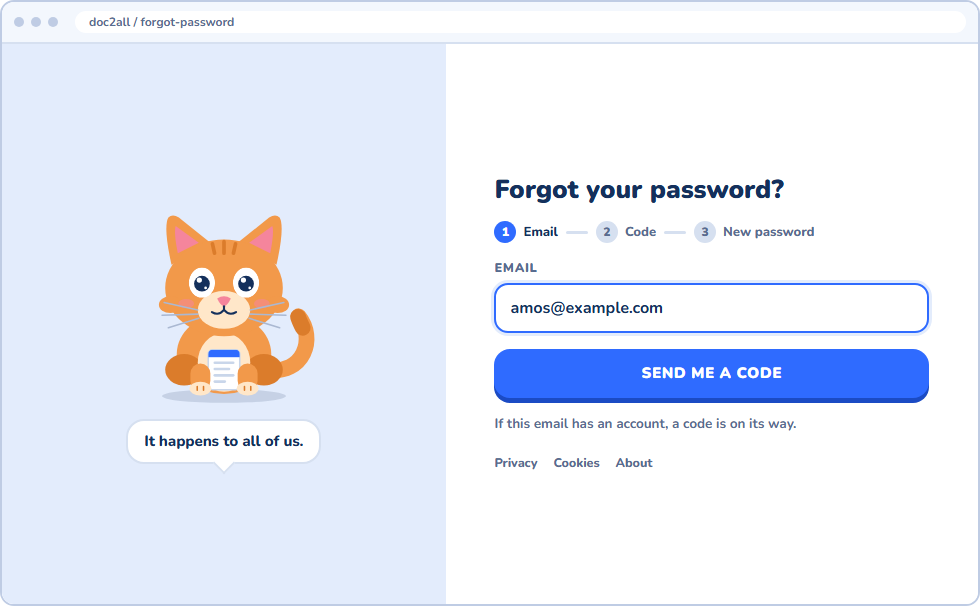

## 5. Upload and choose

The four steps of NFR-01 stay on top. Clean options name what was found and let the user keep what they need. Anything that runs by itself is always removed. Attached files and form scripts go unless the user keeps them. Code written as text is never touched. Black out shows every match highlighted before anything is removed.

- Views: Choose, Clean options, Black out preview, Checking, File refused
- Requirements: FR-02, FR-03, FR-04, FR-05, FR-06, SR-08, SR-09, SR-12, SR-14, SR-15, SR-16, NFR-01, NFR-11, AC-03, AC-05, AC-17

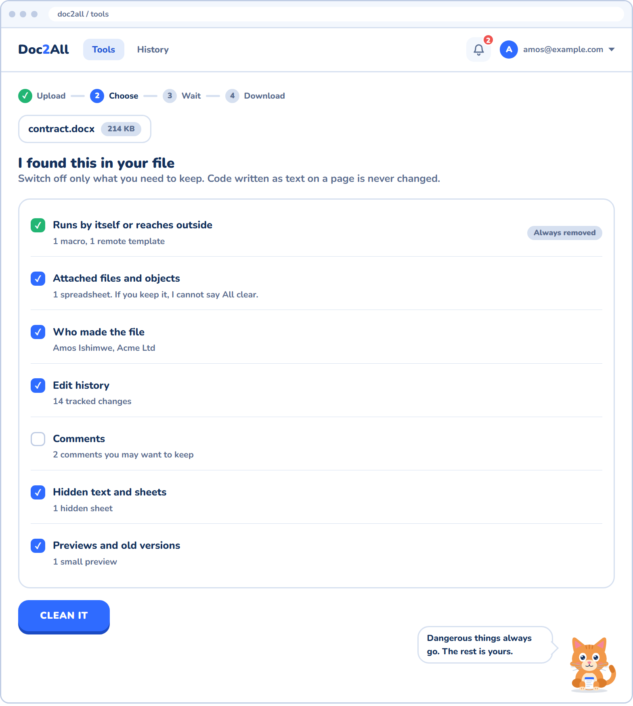

## 6. Consent for outside OCR

The private choice is already selected and has the big button. Using an outside service is a clear, separate action, for this one file only.

- Views: Ask
- Requirements: FR-03, SR-17

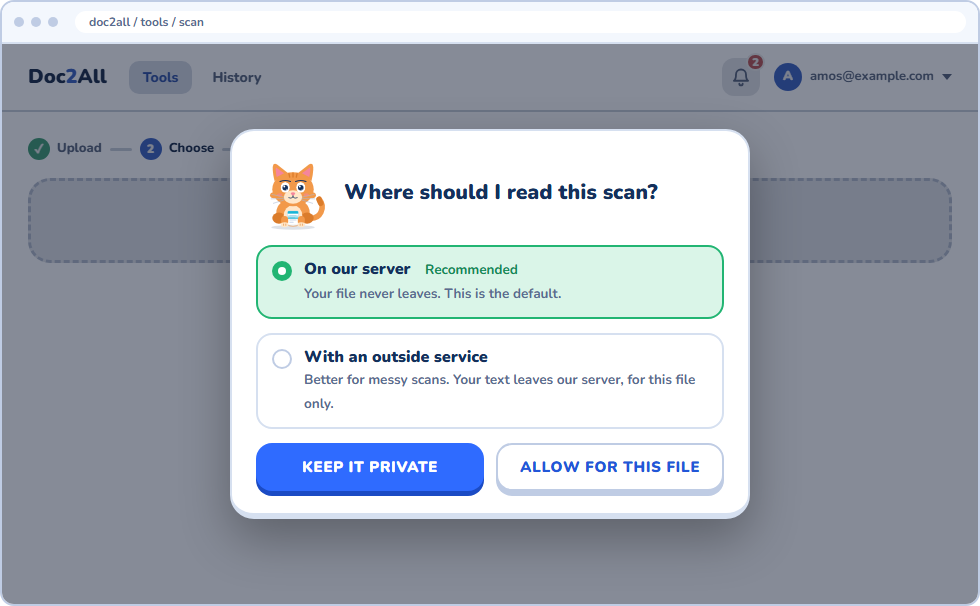

## 7. Safety report

Every finding is one sentence that says what it means and what was done. What the user chose to keep is named too, and a file that keeps something that can run is never All clear. One short sound plays when the report appears. The buttons are centred: the main action first, the others under it.

- Views: All clear, Something kept, Problem found
- Requirements: FR-05, FR-07, SR-15, SR-16, SR-18, NFR-02, NFR-11, AC-12, AC-17

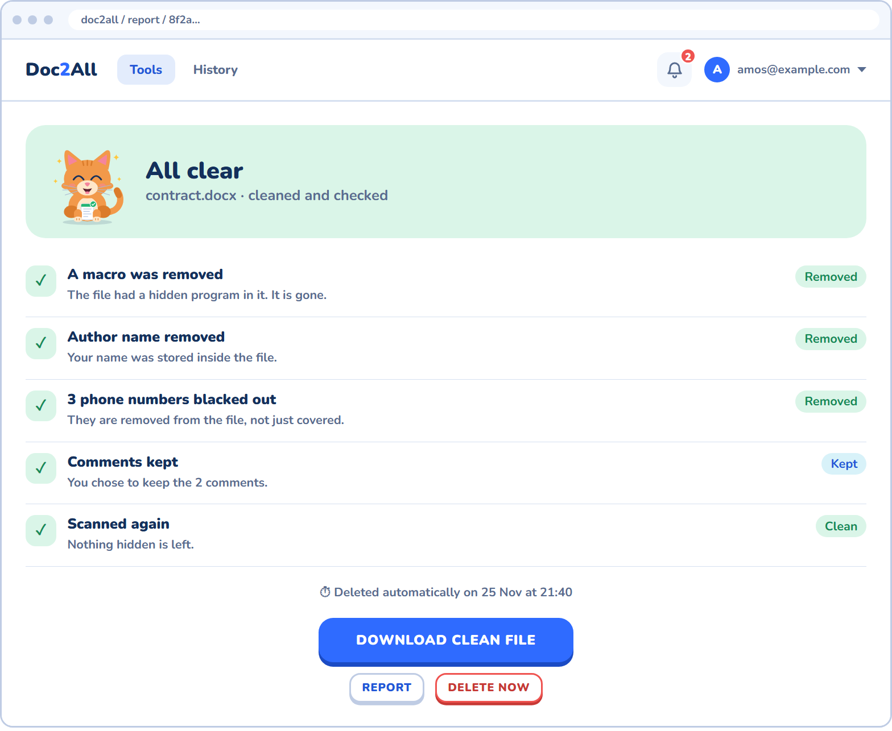

## 8. History

The bell keeps a count and a list. A security notice, like a new passkey, stays pinned at the top until the user answers it. The profile menu holds Settings and Sign out. After 30 minutes of nothing, the session ends with a friendly message.

- Views: Your files, Pinned notice, Notifications, Profile menu, Session ended
- Requirements: FR-08, SR-03, SR-04, SR-18, SR-26, SR-28, SR-29, AC-02

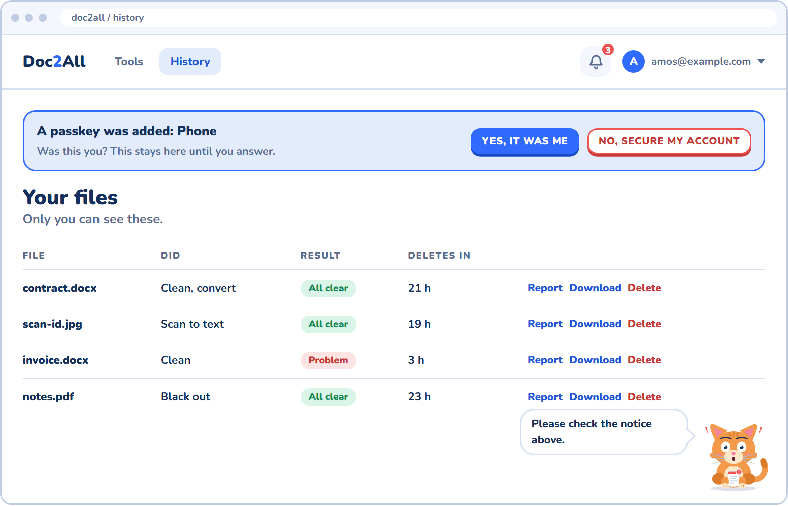

## 9. Delete confirmation

The red button says exactly what happens. Afterwards the cat confirms it is gone and says what was written to the log: the time, never the content.

- Views: Ask, Deleted
- Requirements: FR-08, SR-18, SR-20

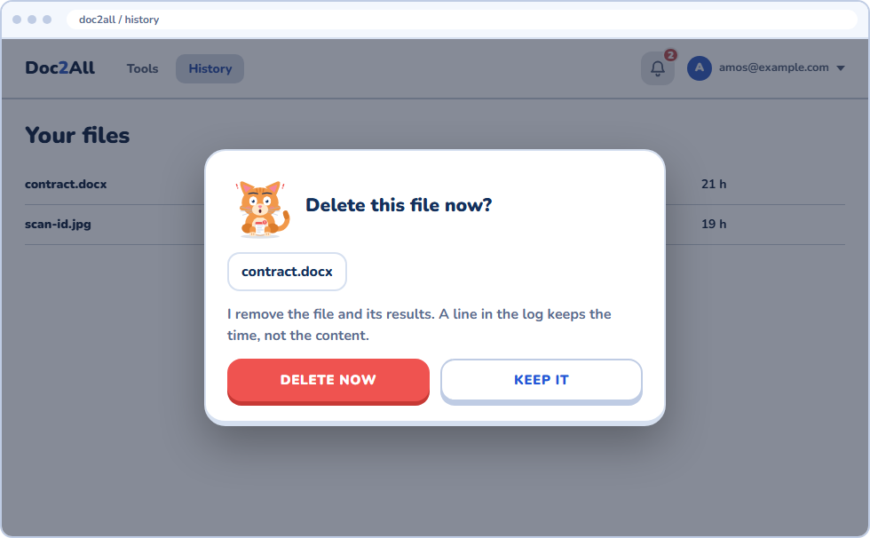

## 10. Settings

Settings sit under the profile menu. Privacy, cookies and About live here, and the same three links are at the bottom of every sign-in screen. Any security change asks for the second step again.

- Views: Security, Confirm it is you, Privacy, Notifications, About
- Requirements: FR-11, FR-12, SR-03, SR-18, SR-19, SR-26, SR-27, SR-28, SR-29, NFR-11, AC-18

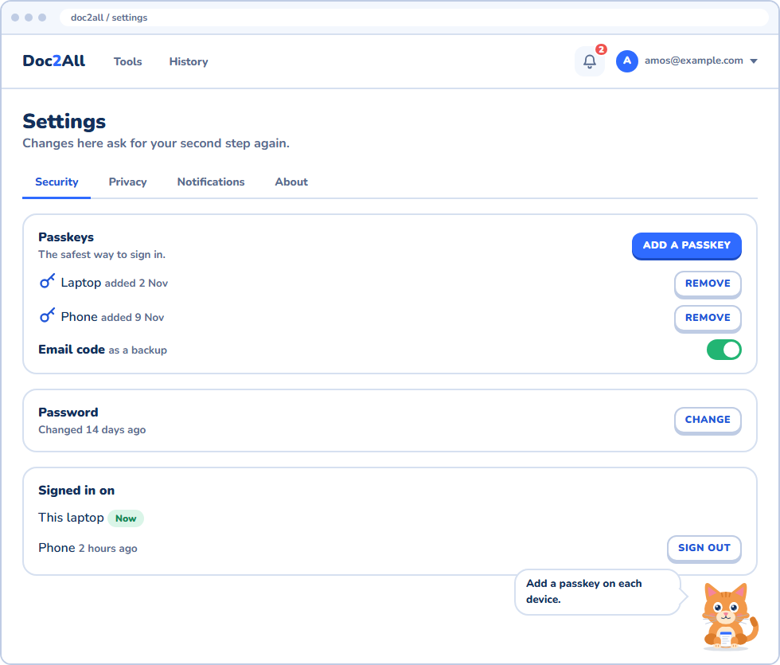

## 11. Audit log (admin)

An administrator sees who did what and when, and nothing else. When they try to look inside a record, the screen says the content is not available, in so many words.

- Views: Log, One record
- Requirements: SR-06, SR-19, SR-20, AC-10

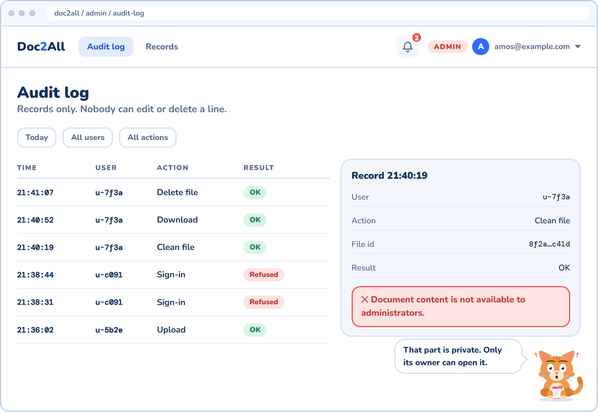
